# Admin Dashboard

The Admin Dashboard is the administration interface built into the Griptape Nodes editor. Organization owners use it to issue and manage license keys, organize users into access groups, control which libraries, nodes, models, and projects each user can access, and, in beta, set credit budgets and audit where credits are spent.

## Who can use it

The Admin Dashboard manages **organizations you own** through Griptape Cloud. It is only available when you are **signed in with a Griptape Cloud account**.

In the desktop application this means the dashboard appears only for users who signed in through **Login or Sign-Up**, not for seats activated with a license key. License activation (see [Using the Admin Server](using_the_admin_server.md)) creates a session with no cloud account behind it: those users are the seats being managed, and the **Admin Dashboard** menu entry never appears for them. The entry is also hidden when your active organization is one you do not own.

If you own more than one organization, an organization switcher in the dashboard's top bar lets you move between them; you can never switch into an organization you do not own.

## Opening the Admin Dashboard

In the desktop application, open the profile menu in the top-right corner (the button showing your name) and choose **Admin Dashboard**.

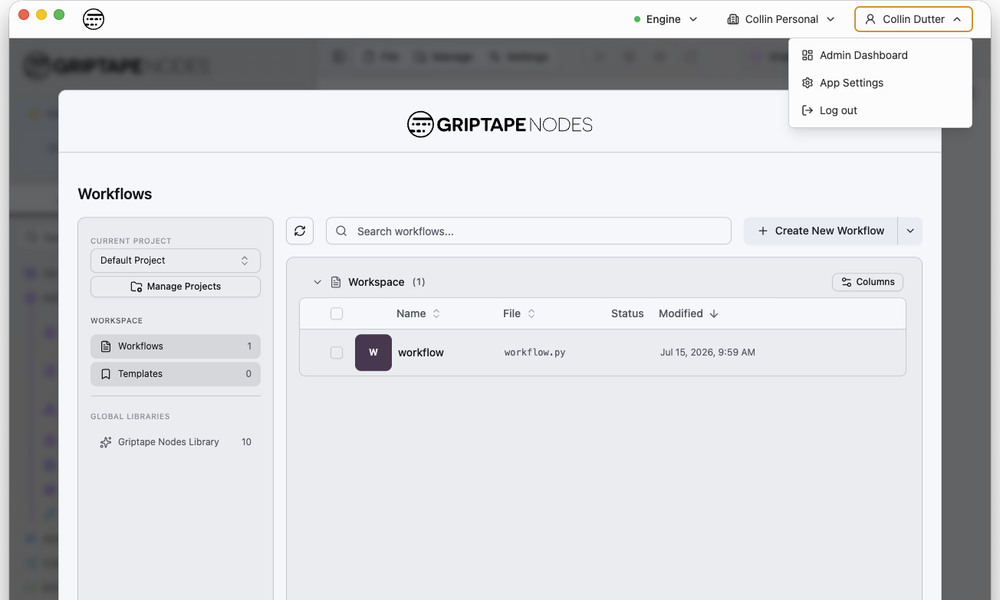

The dashboard opens in its own window, separate from the editor, so you can administer licenses side by side with your work. Choosing **Admin Dashboard** again focuses the existing window. Closing it does not affect the editor.

!!! note "Also available in the web editor"

    The same dashboard is available in the Griptape Nodes web editor: open the user menu in the bottom-left corner and choose **Admin Dashboard**. There it replaces the editor view, and the **Back to Editor** link in the top bar returns you to your workflow.

The dashboard has:

- A **top bar** with a **Back to Editor** link, the active organization (or an organization switcher), and the signed-in user.
- A **sidebar** with the sections: **License Keys**, **Access Groups**, and **Permission Editor**, plus **Spend & Budgets** and **Usage Audit** when their [beta](#turning-on-spend-budgets-and-usage-audit) is turned on.
- A **Dashboard Settings** menu pinned to the bottom of the sidebar, with links to the onboarding guide and this documentation.

### The welcome dialog

On your first visit, a welcome dialog summarizes assigned licenses, permission templates, and active sessions. It also offers three "Get Started" shortcuts:

1. **Create a license key for each user.** Generate a unique key per seat and send it to the user; they paste it into Griptape to activate their access.
1. **Create sets of license keys as access groups.** Group keys by department or project, then assign permission templates to the whole group.
1. **Customise permissions per project.** Build permission templates that control access studio-wide or per project.

Check **Don't show this again** to dismiss it permanently; you can bring it back at any time via **Dashboard Settings → Onboarding Guide**.

## License Keys

The **License Keys** section is the home page of the dashboard. It is where you issue seats: one license key per user, delivered to them as a token they paste into the desktop application (see [Using the Admin Server](using_the_admin_server.md) for the user-side activation flow).

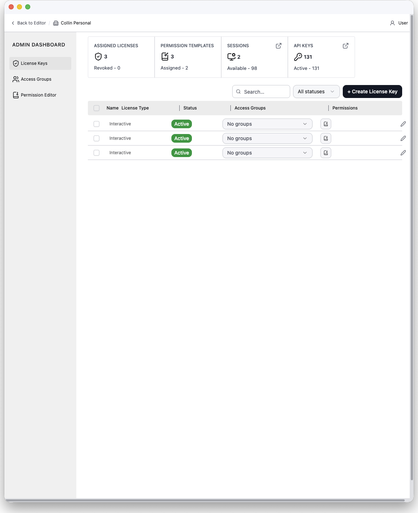

### The stats bar

Four tiles across the top summarize the organization:

| Tile                     | Shows                                          | Click action              |
| ------------------------ | ---------------------------------------------- | ------------------------- |
| **Assigned Licenses**    | Total license keys, plus how many are revoked. | None                      |
| **Permission Templates** | Total templates, plus how many are assigned.   | None                      |
| **Sessions**             | Active sessions, plus how many are available.  | Opens the Sessions modal. |
| **API Keys**             | Total API keys, plus how many are active.      | Opens the API Keys modal. |

### The license table

Each row is one license key with:

- **Name:** usually the user or seat it belongs to.
- **License Type:** `Interactive` (a person using the editor) or `Headless` (automated or unattended use).
- **Status:** `Active`, `Revoked`, or `Expired`.
- **Access Groups:** an inline multi-select for the groups this key belongs to. With multiple rows selected, changing the value applies to every selected row.
- **Permissions:** a popover listing every permission template that applies to the key, both directly assigned and inherited through access groups. Inherited entries show the source group. Templates can be removed from here.
- **Actions:** Edit, Reissue token, Revoke, and Delete.

The toolbar above the table provides search, a status filter, and the **+ Create License Key** button. Column headers sort; columns are resizable.

### Creating license keys

Click **+ Create License Key**. The dialog accepts:

- **License Name(s):** one or more names. Adding several names creates a batch of keys in one step, one per name.
- **License Type:** `Interactive` or `Headless`. This **cannot be changed** after creation.
- **Expiration Date:** required; must be between 1 and 730 days from now.
- **Access Groups:** optionally add the new key(s) to existing groups.

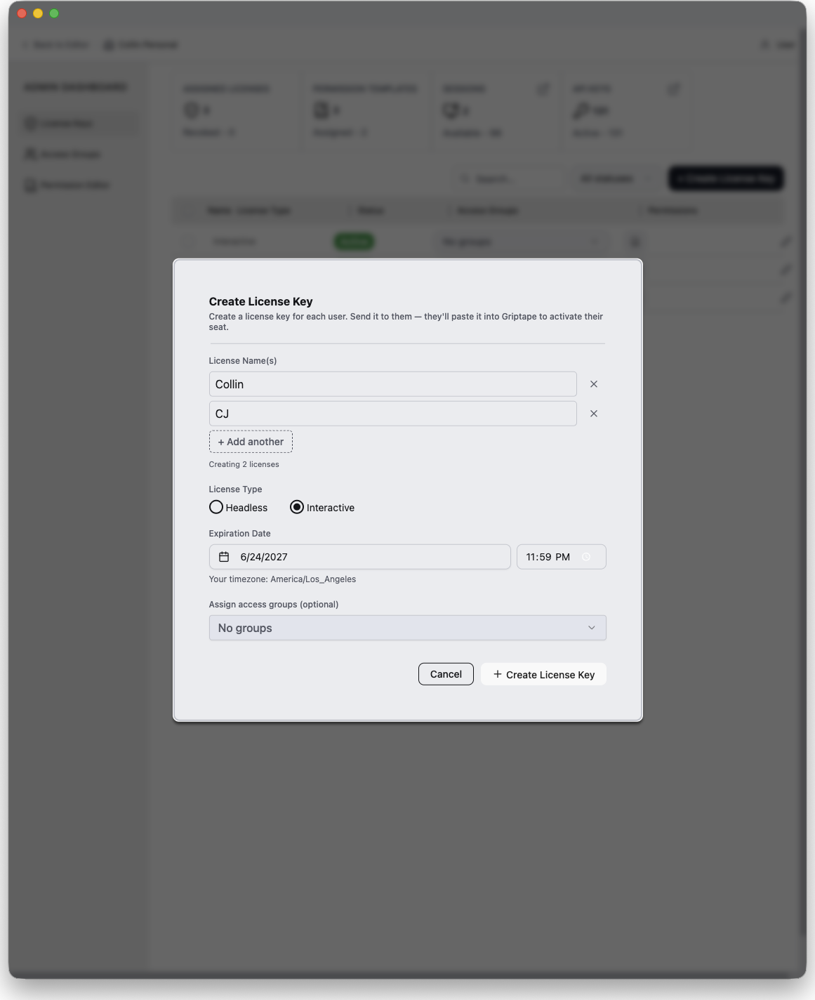

When creation succeeds, a dialog reveals each license token **exactly once**. Copy the tokens and deliver them to the users. They cannot be retrieved later. If you lose one, use **Reissue** to generate a replacement.

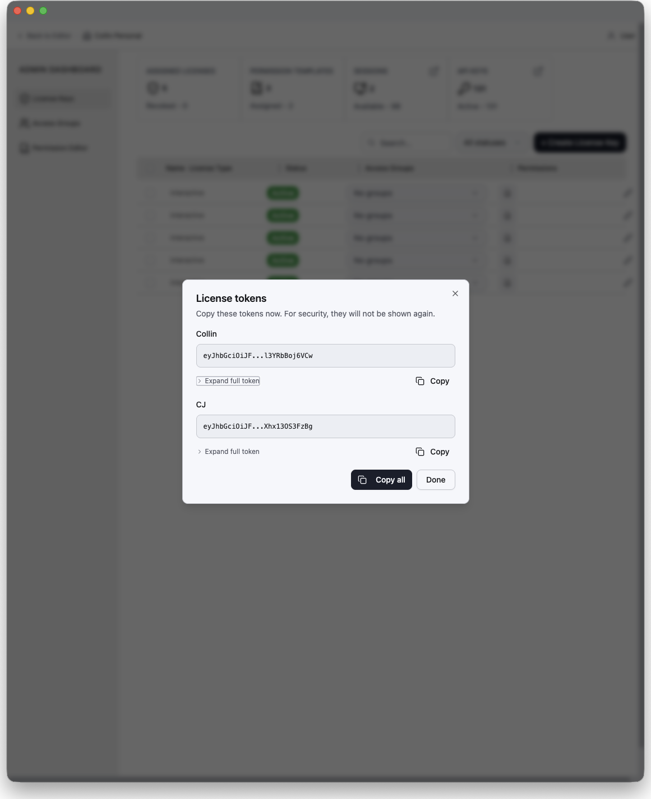

### Managing license keys

- **Edit:** rename the key and change its access group membership.
- **Reissue token:** generate a replacement token for the same license. It is shown once.
- **Revoke:** release the key's existing sessions and prevent the token from allocating new sessions. Only active keys can be revoked or reissued.
- **Delete:** permanently remove the key. This cannot be undone.

### Sessions

Click the **Sessions** tile to open the Sessions modal. It lists your organization's sessions with the session ID, the license key that holds it, status, expiry, and creation time, filterable by status. From here you can:

- **Release** a session, with a configurable grace period, freeing the seat for another user.
- **Delete** a session record.

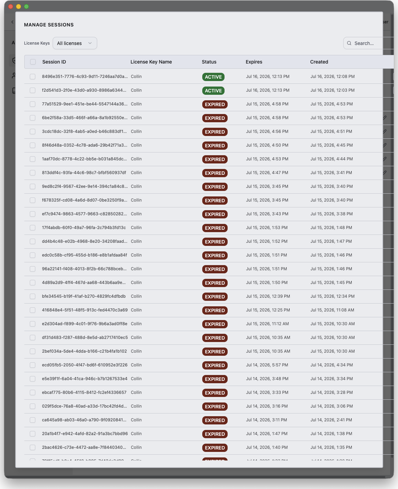

### API Keys

Click the **API Keys** tile to open the API Keys modal, which manages your organization's Griptape Cloud API keys. For example, an [Admin Server](admin_server.md) uses one. A key's value is revealed once, so copy it immediately. You can also delete keys that are no longer needed.

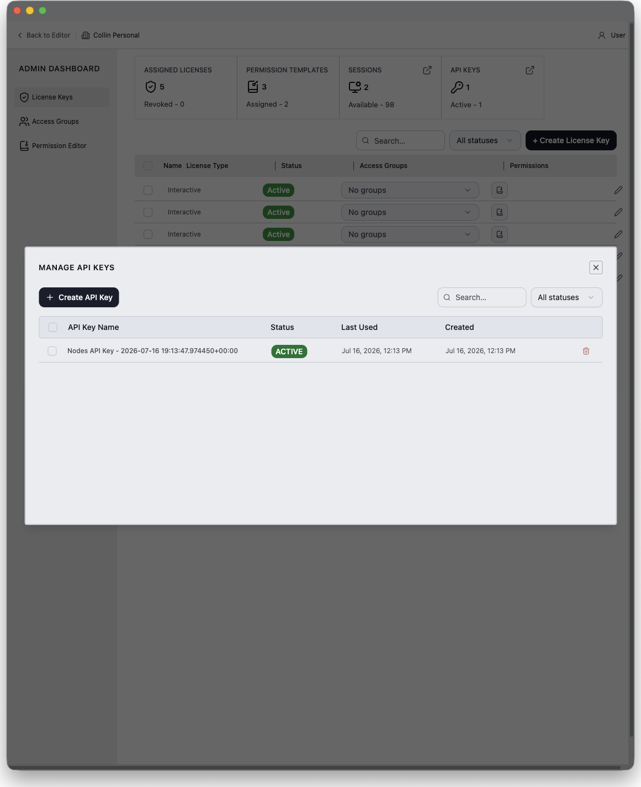

## Access Groups

Access groups collect license keys by department, team, or show so permissions can be managed for the whole set. A permission template assigned to a group applies to every license key in it.

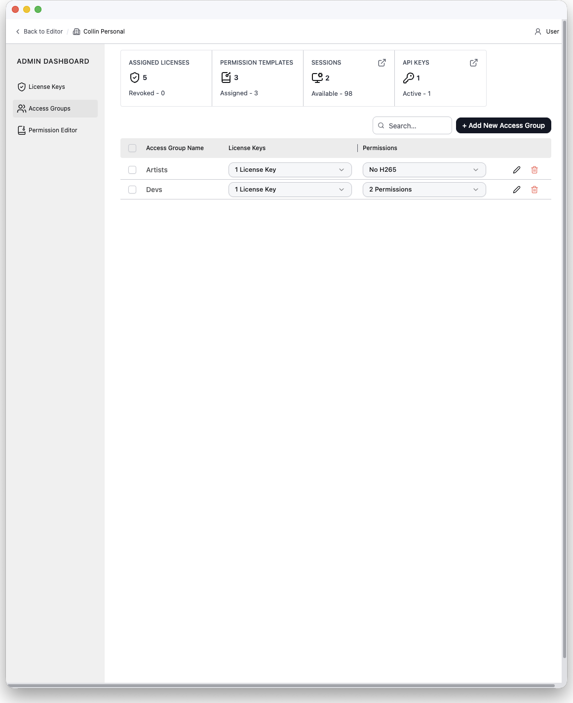

Each row is one group with:

- **Access Group Name**
- **License Keys:** an inline multi-select of the keys in the group.
- **Permissions:** an inline multi-select of your templates and Griptape-managed templates assigned to the group. Griptape-managed templates have a Managed badge.

Create a group with **+ Add New Access Group**, giving it a name and optionally its initial license keys and permission templates. Groups can be edited or deleted from their row; deleting a group does not delete its license keys.

## Spend & Budgets

!!! warning "Beta"

    **Spend & Budgets** and **Usage Audit** are in beta. They may change before they leave beta, and they are hidden until you turn them on. See [Turning on Spend & Budgets and Usage Audit](#turning-on-spend-budgets-and-usage-audit).

**Spend & Budgets** is where you cap how many credits your organization spends on AI models. A budget is a credit limit on one part of your organization, such as a show, a sequence, an artist's license key, or a department, over a period such as a month.

Griptape Cloud checks the budgets that cover a call **before** the model runs. If the call would put a budget with a **Hard Limit** over its limit, the call is refused, nothing is charged, and the run stops at that node. The artist sees which budget stopped it; see [What artists see when a budget stops them](#what-artists-see-when-a-budget-stops-them).

### Turning on Spend & Budgets and Usage Audit

1. Open the Admin Dashboard.
1. Click the **flask** button in the top bar to open **Admin Beta Features**.
1. Turn on **Admin Beta Features**, then turn on **Spend & Budgets and Usage Audit**.

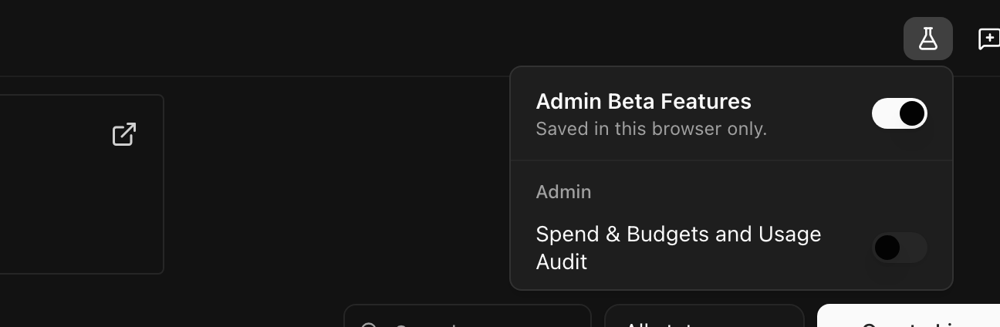

### The overview

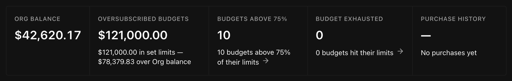

| Card                       | Shows                                                                                                                                                                                                                                                             |
| -------------------------- | ----------------------------------------------------------------------------------------------------------------------------------------------------------------------------------------------------------------------------------------------------------------- |
| **Org Balance**            | The credits your organization has left to spend.                                                                                                                                                                                                                  |
| **Oversubscribed Budgets** | Every budget's limit added together, and how far that total is above your balance. Nested budgets are counted on top of their parents and reset periods are ignored, so this is "how much have we allowed to be spent", not a forecast. Use it as a sanity check. |
| **Budgets Above 75%**      | How many budgets have used more than 75% of their limit. Click the arrow to list them.                                                                                                                                                                            |
| **Budget Exhausted**       | How many budgets have reached their limit. Click the arrow to list them.                                                                                                                                                                                          |
| **Purchase History**       | Your organization's most recent credit purchase and when it was made.                                                                                                                                                                                             |

### The budget table

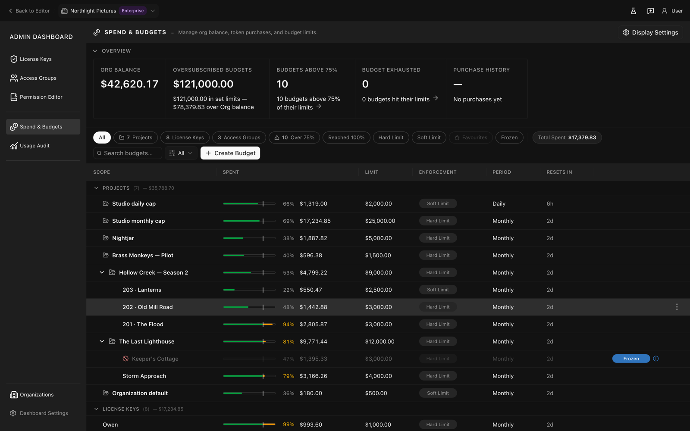

Budgets are grouped into three sections: **Projects**, **License Keys**, and **Access Groups**. Each row shows:

- **Scope:** the budget's name. Budgets for sub-projects are nested under their parent project.
- **Spent:** a bar, the percentage of the limit used, and the amount spent in the current period. A sub-project's spend is included in its parent's.
- **Limit:** the most that may be spent in the period.
- **Enforcement:** **Hard Limit** or **Soft Limit** (see below).
- **Period:** how often spending starts over.
- **Resets In:** how long until the period ends and the spend goes back to zero.

The chips above the table filter it by section, by status (**Over 75%**, **Reached 100%**, **Hard Limit**, **Soft Limit**), or to your **Favourites** or **Frozen** budgets. **Total Spent** is what your organization has spent in total. It comes from your credit history rather than adding up the rows, because a single call counts toward its project, its license key and its access groups at once. The search box matches names, amounts and periods, and also understands searches like `over 80%`.

To edit, favourite, freeze or delete a budget, hover its row and click **⋮**.

### What a budget can cover

When you create a budget you choose its **Scope Type**:

- **Projects:** a project and everything under it. Choose an engine first; its projects are listed so you can pick one, at any depth. A budget on a show covers every sequence and shot in it, and you can add separate budgets for sequences inside it, which are nested under the show in the table.
- **License Keys:** everything one license key spends, whatever project it works in.
- **Access Groups:** everything spent by the license keys in an access group. A key in two groups counts toward both, which is why the **Access Groups** section shows no total.

A call usually falls under more than one budget, for example its sequence, its show, the artist's key and the artist's department. **Every hard-limited budget that covers it must have room for the call**, so the tightest one decides.

#### The organization default

Every organization has a budget named **Organization default**, listed under **Projects**. It counts spend that no project budget covers, so you can see work happening outside your shows. It is always a soft limit: it never blocks anything. You can change its limit and period, but you cannot delete it.

#### Organization-wide caps

To cap everything your organization spends, whatever project or key it comes from, you can create a budget over the whole organization through the Griptape Cloud API. It appears under **Projects**. You can have one per period, so a daily cap can run alongside a monthly one.

### Creating a budget

Click **+ Create Budget**.

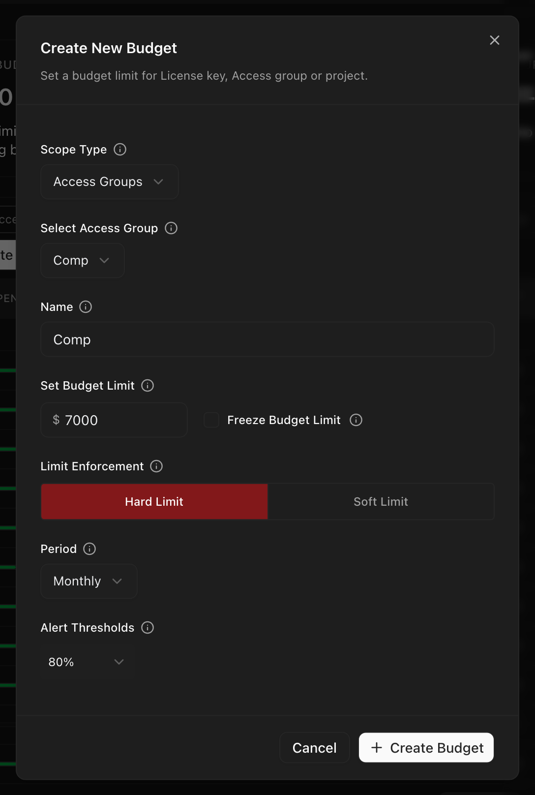

- **Scope Type**, then the project, license key, or access group it covers. The scope cannot be changed later.
- **Name:** how the budget appears in the table and in the message artists see when it stops them. It defaults to the scope's name.
- **Set Budget Limit:** in dollars, for the period.
- **Freeze Budget Limit:** see [Freezing a budget](#freezing-a-budget).
- **Limit Enforcement:**
    - **Hard Limit:** a call that would go over the limit does not run.
    - **Soft Limit:** calls keep running past the limit, and the row shows that the limit was reached. Use it to watch spending without stopping anyone.
- **Period:** **Daily**, **Weekly**, **Monthly**, **Yearly**, or **Lifetime**. Periods start at midnight UTC on calendar boundaries; weeks start on Monday. A lifetime budget never resets.
- **Alert Thresholds:** the percentage of the limit, from 75% to 100%, at which the organization's owner is emailed, as well as at 100% (see below). Whatever threshold you choose, the bar in the **Spent** column has a marker at 75% and turns amber once spending passes 75%.

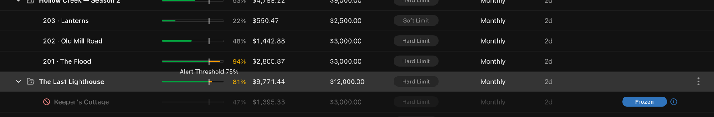

When a budget passes a threshold, the organization's owner gets an email. That includes a budget you edit so that it is already past one, for example by lowering its limit. Every budget also emails at 100%, whatever threshold you chose and whether its limit is hard or soft, and a **Hard Limit** budget that refuses a call sends that 100% email if it hasn't gone out yet. Thresholds crossed at the same moment send one email, for the highest; one crossed later in the period sends another. Raising the limit back above a threshold resets it, so crossing it again sends a new email.

!!! note "Who gets alert emails"

    During the beta, alert emails go only to the organization's owner, the account that created it. They cannot be sent to other people or set per budget yet.

### Freezing a budget

Freezing a budget stops all work under it straight away, whatever is left of its limit. Use it to put a show on hold or to stop a runaway spend. Choose **Freeze** from the row's **⋮** menu, or check **Freeze Budget Limit** when creating or editing it. The row dims and shows a **Frozen** badge. Choose **Unfreeze** to allow work again; the limit and spend are unchanged.

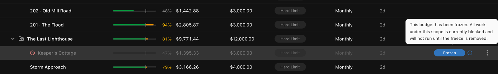

### What counts toward a budget

During the beta, budgets count calls paid for with your organization's **Griptape credits**. Calls that use your own provider API keys are not counted, whether they go through Griptape Cloud or straight to the provider.

### What artists see when a budget stops them

When a budget refuses a call, the node fails and the run stops there. A **Run blocked** bar across the top of the canvas names the node and every budget that stopped it, for example:

> Budget stopped this run. 'Hero Plate Upscale' was blocked by the budget "Storm Approach". Contact your Griptape administrator.

The agent chat shows a similar message when a budget stops a reply. Nothing is charged for a refused call. To let the work continue, raise the budget's limit, unfreeze it, or wait for its period to reset. See [Running workflows](../guides/editor/running_workflows.md#when-a-budget-stops-a-run) and [the agent guide](../guides/agent/index.md#when-a-budget-stops-a-reply) for what artists see.

## Usage Audit

!!! warning "Beta"

    **Usage Audit** is in beta and hidden until you turn it on with **Spend & Budgets**. See [Turning on Spend & Budgets and Usage Audit](#turning-on-spend-budgets-and-usage-audit).

**Usage Audit** shows where your organization's credits went, so you can see which shows, artists and models are spending, and set budgets to match.

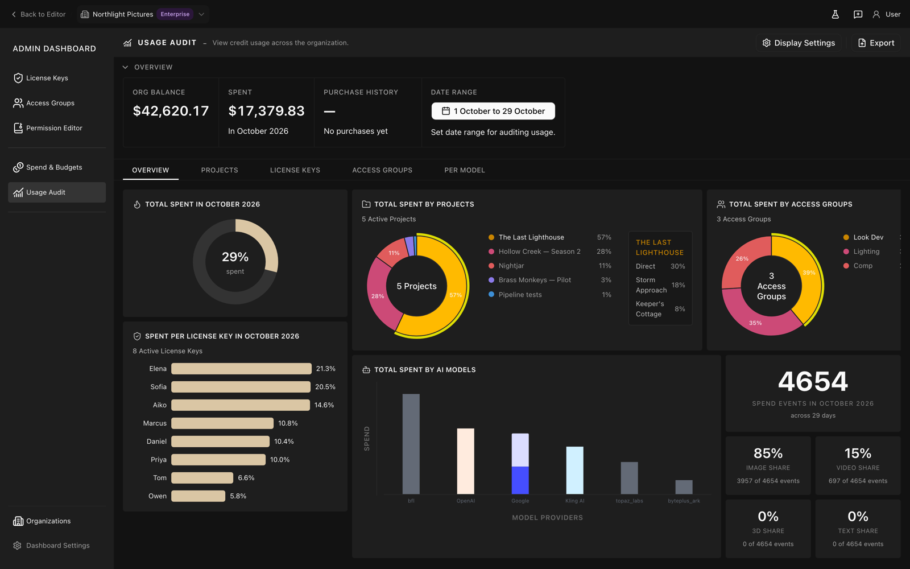

### Choosing the dates

The page opens on the current month so far. Click the dates in the **Date Range** card to choose a different range, then **Apply**. Every chart and total on the page uses the range.

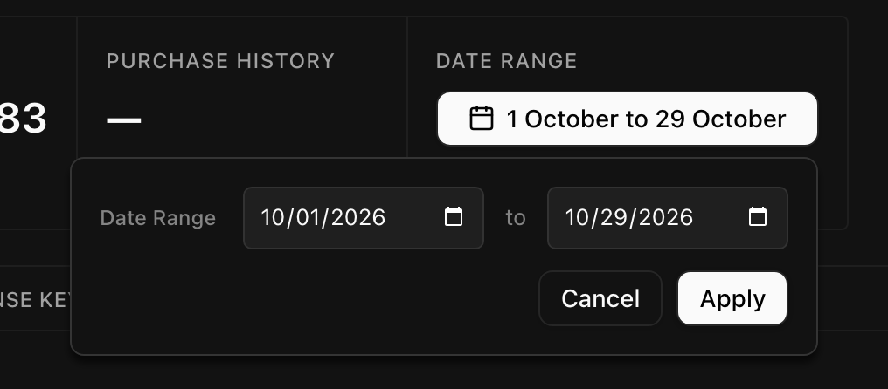

### The tabs

- **Overview:** the total spent in the range, spend by project, by license key, by access group, and by model provider, and how many calls there were of each kind (image, video, 3D, text).
- **Projects:** pick a project from the list to see its spend over time, which models it used, and how it stands against its budget. The list is nested the same way as your projects, and a warning icon marks any above 75% of its budget.
- **License Keys:** the same, per license key.
- **Access Groups:** the same, per access group. A key in two groups counts toward both, so group totals can add up to more than your organization spent.
- **Per Model:** spend by model provider, and within each provider by model.

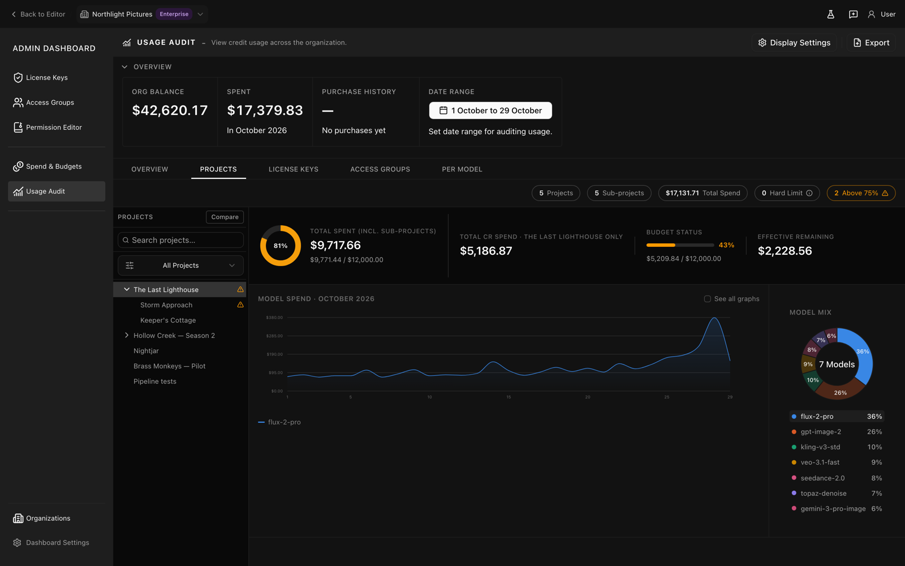

### Exporting usage

Click **Export** to download every spend record in the date range, one row per call, for your own reports.

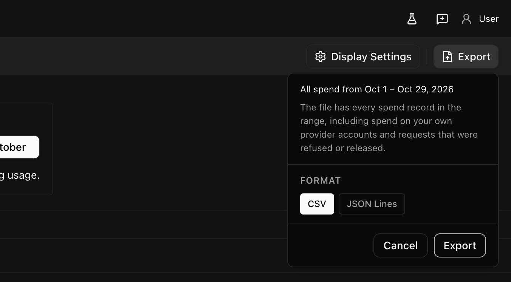

- **Format:** **CSV** for spreadsheets, or **JSON Lines** for scripts.
- **Tags:** which tags become columns, such as `project`. All are included unless you uncheck them.

The file includes calls on your own provider accounts and calls that were refused, which the charts leave out. It is prepared on the server, so you can close the menu or leave the page; a notification offers the download when it is ready.

## Permission Editor

The Permission Editor is where you author **permission templates**: named policies that decide what a license key is allowed to do. Templates are assigned to access groups or directly to individual license keys; a key's effective permissions are the combination of everything assigned to it, and an explicit deny always wins over an allow.

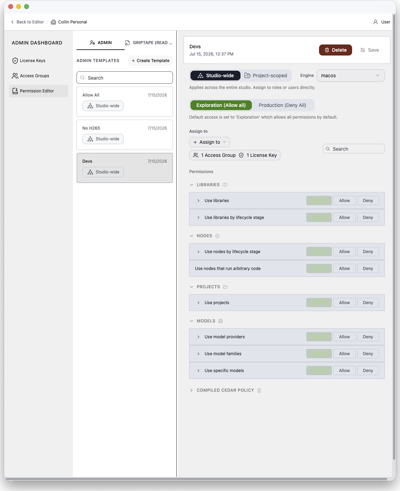

### Template list

The left panel lists templates in two tabs:

- **Admin:** templates authored by your organization's admins. Fully editable.
- **Griptape (read-only):** templates authored and maintained by Griptape. You can attach them to access groups or license keys and audit their contents, but not modify them.

Search filters both tabs. **+ Create Template** opens the creation dialog.

### Creating a template

The creation dialog asks for:

- **Template Name**
- **Authoring mode**:
    - **Permission Builder:** configure permissions with the visual builder described below. This is the recommended mode.
    - **Raw Cedar:** write the policy by hand in a [Cedar](https://www.cedarpolicy.com/) editor after creation. The builder is not available for raw Cedar templates.
- **Scope** (builder mode only): **Studio-wide** or **Project-scoped** (see below).

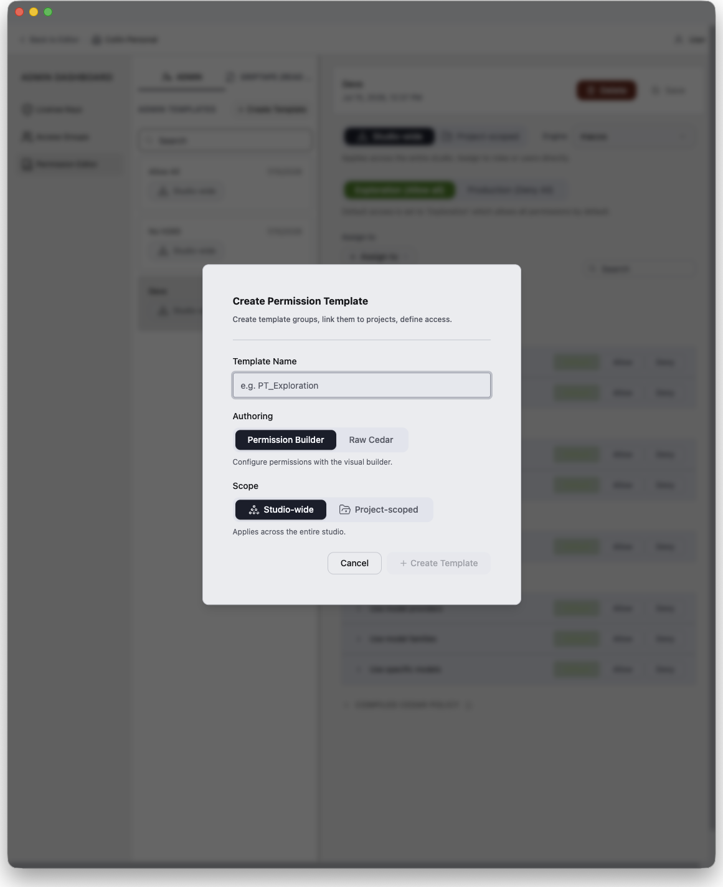

### The permission builder

Selecting a builder template opens its detail panel, which is organized top to bottom:

#### Scope

A template is either:

- **Studio-wide:** applies across the entire studio, everywhere the license is used.
- **Project-scoped:** linked to a specific project template on an engine. Its statements apply only while the engine works in that project or its project ancestry.

The scope row also selects an **Engine**. Connecting an engine loads a manifest containing its installed libraries, project templates, models, and model providers. The manifest populates the builder's pickers, so you can select resources by name. Project-scoped templates also require a **Linked project** from the engine's project templates.

#### Default access

The template's base posture, which decides what happens to anything you do not explicitly configure:

- **Exploration (Allow all):** everything is allowed by default; you deny specific things. Suited to look-development and R&D.
- **Production (Deny All):** everything is denied by default; you allow specific things. A lockdown posture for shows in production.

Explicit per-permission choices keep their meaning if you later switch the posture.

#### Assign to

Attach the template to **access groups** and/or directly to individual **license keys**. Assignments through a group reach every key in the group.

#### Permissions

The permission list is a catalog of capabilities grouped by category. Each row can be set to **Allow** or **Deny**, or left on **Default** to follow the posture, and most rows can be **scoped to specific resources** (for example, deny only certain libraries rather than all of them):

| Category      | Capability                        | What it controls                                                                                                                 | Scopeable to       |
| ------------- | --------------------------------- | -------------------------------------------------------------------------------------------------------------------------------- | ------------------ |
| **Libraries** | Use libraries                     | Loading node libraries.                                                                                                          | Specific libraries |
| **Libraries** | Use libraries by lifecycle stage  | Loading libraries at specific lifecycle stages (`STABLE`, `BETA`, `ALPHA`, `LABS`, `DEPRECATED`).                                | Lifecycle stages   |
| **Nodes**     | Use nodes by lifecycle stage      | Using nodes at specific lifecycle stages.                                                                                        | Lifecycle stages   |
| **Nodes**     | Use nodes that run arbitrary code | Nodes whose library declarations mark them as executing arbitrary Python.                                                        | Not scopeable      |
| **Projects**  | Use projects                      | Loading and activating projects.                                                                                                 | Specific projects  |
| **Models**    | Use model providers               | Every model under a provider. Denied models are filtered out of model pickers and blocked from invocation; nodes stay creatable. | Specific providers |
| **Models**    | Use model families                | Models in specific families (e.g. Claude 4, GPT-4). Same picker filtering and invocation blocking as providers.                  | Specific families  |
| **Models**    | Use specific models               | Individual models by id. Same picker filtering and invocation blocking.                                                          | Specific models    |
| **Video**     | Use video codecs                  | Reading and writing video by codec (for example `h264`, `hevc`, `prores`).                                                       | Specific codecs    |

When a template conflicts with another template or access group for the same license keys, affected rows show a warning naming the conflicting templates and keys. For example, one template may allow a capability that an assigned group's template denies. A deny always wins.

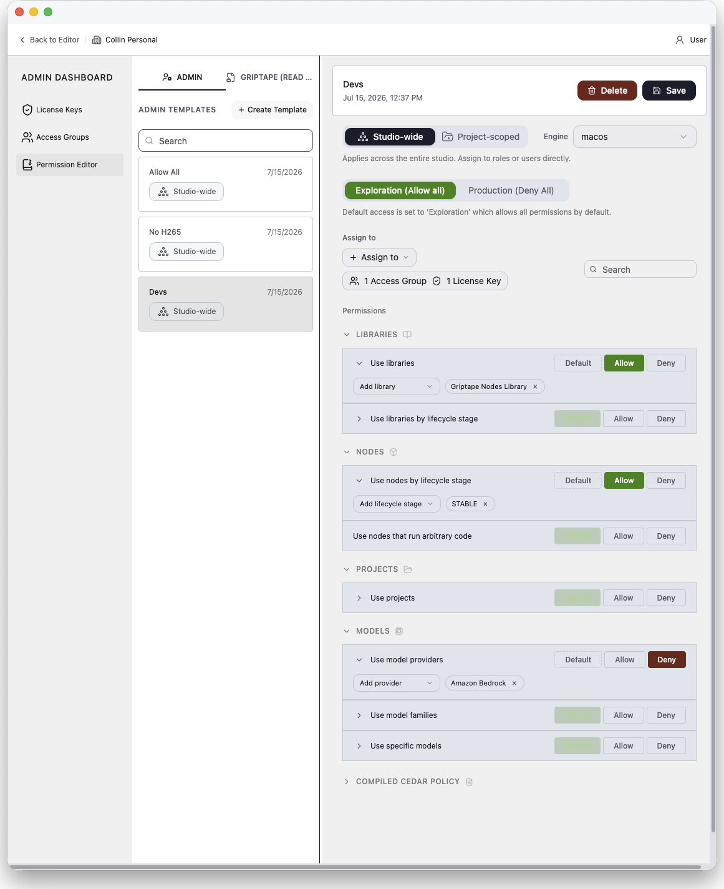

#### Compiled Cedar

The builder compiles your choices into [Cedar](https://www.cedarpolicy.com/) policy statements. Griptape Nodes evaluates those statements at authorization checkpoints. The **Compiled Cedar Policy** section is collapsed by default and shows the Cedar from the last save. See [Cedar Policies](cedar_policies.md) for details.

### Raw Cedar templates

Templates created in **Raw Cedar** mode skip the builder and expose a Cedar editor with syntax validation. A template with syntax errors cannot be saved. Validation does not check action or attribute names against the engine's Cedar schema, so review them carefully. A read-only statement summary above the editor breaks the policy down per statement, and the same **Assign to** controls apply. New raw templates start with `permit(principal, action, resource);` (allow everything), mirroring the builder's exploration default.

Write raw templates when the capability catalog does not cover the rule you need. [Cedar Policies](cedar_policies.md) documents the checkpoints, resource attributes, and context facts a statement can match on, with worked examples.

### Griptape-managed templates

Selecting a template on the **Griptape (read-only)** tab shows its description, a per-statement breakdown of its permissions, and its full Cedar source. Managed templates cannot be edited or deleted. You can only attach them to or detach them from access groups and license keys.

## How it fits together

A typical rollout looks like:

1. **Create permission templates** in the Permission Editor. For example, create an "Exploration" template for R&D and a locked-down "Production" template that only allows approved libraries and model providers.
1. **Create access groups** for each team or show, and assign each group the appropriate templates.
1. **Create a license key per user**, adding each key to the right access groups, and send each user their token.
1. Users **activate** their seats by pasting the token into the desktop application. On-premises deployments use an [Admin Server](admin_server.md). License-activated users get the editor only; the Admin Dashboard never appears for them.
1. Monitor and manage seats from the License Keys section. Watch active **sessions**, **release** stuck ones, **reissue** lost tokens, and **revoke** keys when someone leaves.
1. In beta, **set budgets** in Spend & Budgets for each show, key or department, and check **Usage Audit** to see where credits are going.
