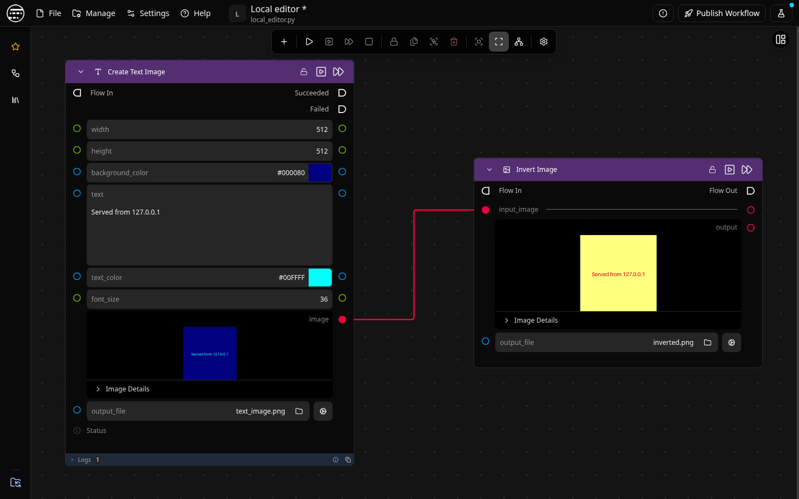

# Running the Editor Locally

The engine can serve the editor itself, so you can build workflows without opening the hosted editor at [nodes.griptape.ai](https://nodes.griptape.ai). The editor loads from your own machine and talks to the engine over the [direct WebSocket](transports.md), so editor traffic never leaves the machine.

[Griptape Nodes Desktop](desktop/app_settings.md) already works this way. This page is for running the engine yourself with `gtn`.



## Set it up

1. Install Griptape Nodes with the `editor` extra, which adds the editor files:

    ```bash
    uv tool install 'griptape-nodes[editor]'
    ```

    If Griptape Nodes is already installed, add `--force` to reinstall it with the extra. Each version of Griptape Nodes installs the one editor version that matches it.

1. Turn on the `websocket_direct` transport, which the local editor uses to reach the engine. Add this to your `griptape_nodes_config.json` (see [Engine Configuration](configuration.md) for where it lives):

    ```json
    {
        "transports": {
            "websocket_direct": {
                "enabled": true
            }
        }
    }
    ```

    Like the other local transports, `websocket_direct` only starts when the engine has a license or a Griptape Cloud API key.

1. Start the engine with `gtn`. When it's ready, it prints the editor's address:

    ```text
    Engine is ready to receive events
    Open: http://127.0.0.1:8126/ to access the Workflow Editor
    ```

1. Open that address in your browser.

## Change the address

The editor is served at `http://127.0.0.1:8126/` by default. To use another port, set it in your config file:

```json
{
    "editor_server": {
        "port": 9000
    }
}
```

| Setting              | Default     | Environment variable         | Description                    |
| -------------------- | ----------- | ---------------------------- | ------------------------------ |
| `editor_server.host` | `127.0.0.1` | `GRIPTAPE_NODES_EDITOR_HOST` | Address the editor listens on. |
| `editor_server.port` | `8126`      | `GRIPTAPE_NODES_EDITOR_PORT` | Port the editor listens on.    |

The environment variables take precedence over the config file. Restart the engine after changing either.

The engine uses exactly the port you set. If another program already holds it, the engine logs an error, skips the local editor, and keeps running. A second engine on the same machine is the usual cause.

!!! warning "Keep it on this machine"

    The editor server has no sign-in. Leave `editor_server.host` on `127.0.0.1` so only programs on this machine can reach it. To use an editor from another machine, see [Reach an engine on another machine](transports.md#reach-an-engine-on-another-machine).

## When the editor doesn't start

If the engine's ready message says `Return to: https://nodes.griptape.ai` instead of a local address, the local editor didn't start. Check the engine's log:

- **"Not starting the local editor server: it needs the 'websocket_direct' transport"**: turn on `websocket_direct` as shown in [Set it up](#set-it-up).
- **"Editor server could not bind"**: the port is taken. Stop the other program or [pick another port](#change-the-address).
- **Nothing about the editor**: the `editor` extra isn't installed. Reinstall with `uv tool install --force 'griptape-nodes[editor]'`.

## Serve your own editor build

Editor developers can serve a local build of [griptape-vsl-gui](https://github.com/griptape-ai/griptape-vsl-gui) in place of the installed one. Set `GRIPTAPE_NODES_EDITOR_DIST` to the build's `dist/` folder, which must contain `local-parent/` and `editor/`:

```bash
GRIPTAPE_NODES_EDITOR_DIST=~/code/griptape-vsl-gui/dist gtn
```

If the folder is missing either subfolder, the engine logs a warning and falls back to the installed editor.
